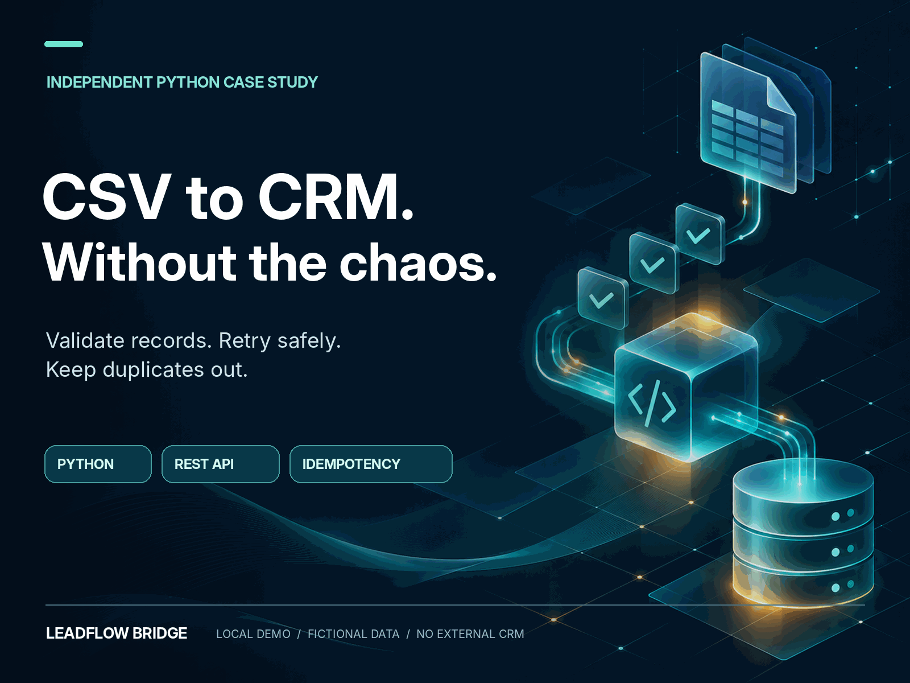
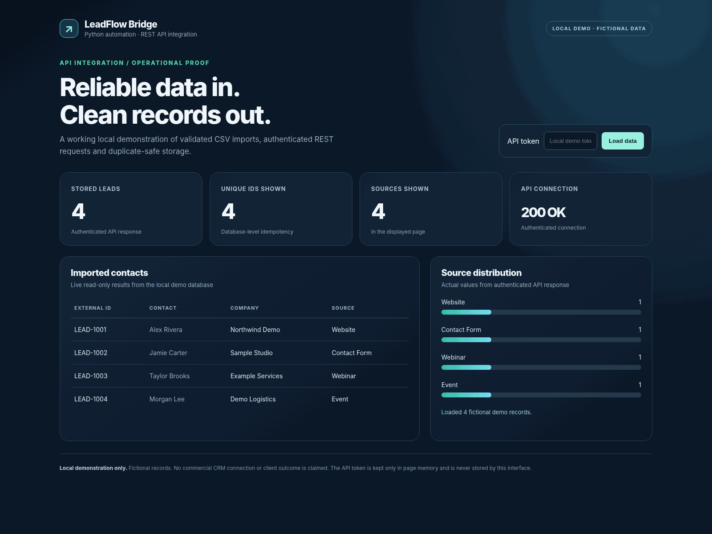
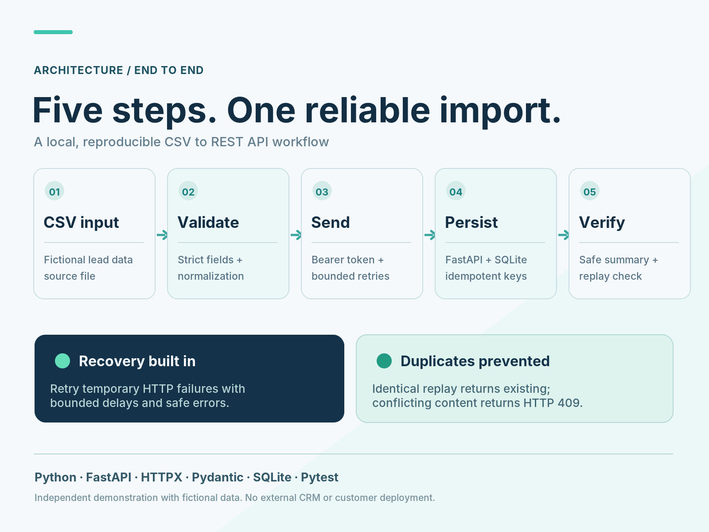

# LeadFlow Bridge

**CSV to CRM, without the chaos.** A reproducible Python integration case study with a real local REST API, strict data validation, bounded retries, duplicate-safe persistence and an interactive read-only dashboard.



> **Scope:** This is an independent, AI-assisted **local demonstration**, not a paid customer project or a connection to HubSpot, Salesforce, or another commercial CRM. It processes **fictional example records only**. Nothing is transmitted to a third-party service.

## In 30 seconds

The recurring problem: CSV files often contain inconsistent fields, invalid contacts or repeated entries. Moving them into another system needs validation, API authentication, reliable error handling and safe replays. This reference project demonstrates those moving parts in a compact, testable implementation.

| Capability | Demonstrated behavior |
| --- | --- |
| Validated CSV imports | Required and duplicate/unknown headers rejected, individual invalid rows reported |
| Authenticated API integration | Bearer token and idempotency key sent over REST |
| Safe retry policy | Bounded retries on transient HTTP/network errors; invalid `Retry-After` is handled |
| Duplicate-safe storage | SQLite unique IDs, `201` for new, `200` for identical repeat, `409` for conflict |
| Dashboard | Read-only browser view of the authenticated local database; token only in memory |
| API queries | Deterministic bounded pagination with `limit`, `offset`, `count` and `total` |
| Verification | Automated tests and a real localhost HTTP demonstration |



The image above is a rendering of the real dashboard using an authenticated response from the local API. In this restricted authoring environment Chromium could not navigate to localhost, so the screenshot uses the **real HTTP response injected into the browser renderer**. It is **not** claimed as a successful browser-to-server HTTP test. The API and CLI integration are tested over real HTTP separately.

## Quick start

Requires **Python 3.10+** and a terminal. No paid services, external credentials or real customer data.

```bash
python -m venv .venv
# Linux/macOS:
. .venv/bin/activate
# Windows PowerShell: .\.venv\Scripts\Activate.ps1
python -m pip install -e ".[dev]"
python scripts/run_demo.py
python -m pytest -q
```

The one-command demo starts a local API on an available loopback port, processes four fictional records twice, checks persisted data and stops the server. Expected results:

```text
Pass 1: 4 created, 0 already present
Pass 2: 0 created, 4 already present
Persisted: 4 records; normalization checked
```

### Open the interactive dashboard

In terminal 1, set a *local-only* token and start the API:

```bash
# Linux/macOS
export LEADFLOW_API_TOKEN="local-test-token-change-me"
leadflow serve --db demo_crm.sqlite
```

In terminal 2, with the same environment variable:

```bash
leadflow sync examples/leads.csv --report sync_report.json
leadflow sync examples/leads.csv
```

Open **http://127.0.0.1:8765/dashboard**, enter the local token and choose **Load data**. The browser reads `GET /api/leads` using the bearer token; it does not store the token in `localStorage` or cookies. Swagger/OpenAPI documentation is also available locally at **http://127.0.0.1:8765/docs**.

Windows PowerShell equivalent for each terminal:

```powershell
$env:LEADFLOW_API_TOKEN = "local-test-token-change-me"
.\.venv\Scripts\leadflow.exe serve --db demo_crm.sqlite
# In another PowerShell window, with the same token:
.\.venv\Scripts\leadflow.exe sync examples/leads.csv
```

## How it works



1. The importer loads CSV rows with `external_id`, `name`, `email`, `company` and `source`.
2. Pydantic validates each record and normalizes email casing. Invalid rows are reported by line number without echoing submitted contact values. Duplicate/unknown CSV header names fail before sending any requests.
3. The HTTPX client uses a bearer token and a stable `Idempotency-Key`. It retries connection failures and HTTP 429, 500, 502, 503 and 504 up to the configured bound.
4. The local FastAPI demo CRM validates requests and stores them in SQLite with a unique external ID.
5. Repeated identical input returns `200`; a changed payload for the same ID returns `409`.

### API contract

| Method | Endpoint | Description |
| --- | --- | --- |
| GET | `/healthz` | Local health check |
| POST | `/api/leads` | Authenticated insert / duplicate / conflict |
| GET | `/api/leads?limit=100&offset=0` | Authenticated, paginated records |
| GET | `/dashboard` | Read-only interface requiring a token for data access |
| GET | `/docs` | Interactive OpenAPI documentation |

The demo server binds to `127.0.0.1` by default. The HTTP client requires HTTPS for non-local endpoints and disables following redirects. **This is not a production-ready CRM service.** Do not put it on the public Internet or import real customer data without a separate security, privacy and operational review. See [Security and limitations](docs/security-review.md).

## Verification and engineering quality

```bash
python -m pytest -q
python scripts/run_demo.py
python -m compileall -q src tests scripts
python -m pip wheel --no-deps . -w dist
```

See [verification logs](verification/) for the exact observed test result and demo output. The project is configured for GitHub Actions tests on Python 3.10, 3.12 and 3.13; **no remote GitHub Actions run is claimed yet**.

The production package includes the local HTML dashboard. Generating screenshot assets additionally requires `python -m pip install -e ".[visual]"` and a Chromium installation compatible with Playwright, see `scripts/capture_portfolio.py`. The included PNG assets do **not** need to be regenerated for normal use.

## Project files

```text
assets/                    Four-by-three portfolio visuals and source art
assets/upwork/             Three ready-to-upload 1000 x 750 PNG images
docs/                      Architecture, limitations, and release notes
examples/                  Synthetic CSV datasets
scripts/run_demo.py        Real HTTP CLI/API integration smoke test
scripts/capture_portfolio.py  Browser dashboard capture, with sandbox fallback
scripts/make_portfolio_assets.py  Cover and vector architecture renderer
src/leadflow_bridge/       CLI, models, importer, HTTP client, FastAPI and dashboard
src/leadflow_bridge/static/dashboard.html  Browser UI
tests/                     API, CSV, client, CLI and regression tests
verification/              Executed local tests and smoke evidence
PORTFOLIO_UPWORK.md        Ready-to-paste English and German case study
PUBLISHING_GUIDE.md        GitHub and Upwork publication instructions
```

## Deutsch

**LeadFlow Bridge** ist ein selbstständig entwickeltes, KI-unterstütztes Python-Referenzprojekt. Es überträgt **fiktive** CSV-Kontakte an eine **lokale** REST-API, prüft Datensätze, schützt vor doppelten Einträgen und behandelt vorübergehende Verbindungsfehler. Eine echte Dashboard-Oberfläche zeigt die im lokalen Demo-CRM gespeicherten Datensätze an.

**Start:** Projekt mit `python -m pip install -e ".[dev]"` installieren und `python scripts/run_demo.py` ausführen. Danach mit `python -m pytest -q` die Tests starten. Für das interaktive Dashboard die API mit `leadflow serve` starten, Beispieldaten mit `leadflow sync examples/leads.csv` übertragen und `/dashboard` lokal im Browser öffnen.

**Abgrenzung:** Keine externe CRM-Anbindung, keine Kundendaten, kein produktiver Einsatz. Das Projekt dient ausschließlich als reproduzierbarer Nachweis für Python-Entwicklung, API-Integration, Datenvalidierung, Fehlerbehandlung und Tests.

## Portfolio and publication

See [ready-to-paste Upwork portfolio copy](PORTFOLIO_UPWORK.md) and [publication guide](PUBLISHING_GUIDE.md). The three images in `assets/upwork/` follow the **1000 × 750, 4:3** dimensions recommended by Upwork for portfolio images. [Official Upwork guidance](https://support.upwork.com/hc/en-us/articles/360016144974-How-to-enhance-your-freelancer-profile).

License: [MIT](LICENSE). Project case study attributed to Peter Schuller. Illustrative background art was AI-generated and the full project was created with AI assistance; code behavior was validated locally by executed tests.
