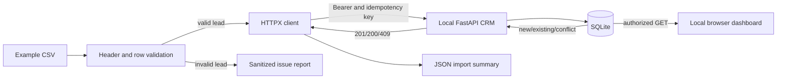

# Architecture and contracts

## Data flow

## Package responsibilities

| Component | Responsibility |
| --- | --- |
| `models.Lead` | Pydantic validation and email normalization |
| `importer.sync_csv` | Required/unknown/duplicate CSV headers, row-level isolation and report |
| `client.CRMClient` | HTTP POST, auth, retry budget and response contract |
| `server.create_app` | Local REST API, SQLite idempotency and paginated reads |
| `static/dashboard.html` | Read-only client for authorized `/api/leads` GET |
| `scripts/run_demo.py` | Reproducible real HTTP API and CLI test |
| `scripts/capture_portfolio.py` | Dashboard screenshot using verified local API data |

## API details

`POST /api/leads` requires `Authorization: Bearer …` and `Idempotency-Key` equal to the `external_id` value in the JSON body. If newly inserted, returns HTTP 201 with `created: true`. If identical, returns HTTP 200 with `created: false`. If the same ID has a different normalized payload, returns HTTP 409 with a generic conflict message. Invalid payloads return HTTP 422.

`GET /api/leads?limit=100&offset=0` is authenticated, sorted by `external_id` and paginated. `limit` must be 1–1000 and `offset` non-negative. `count` represents returned rows and `total` the number of stored records.

Retries apply to connection exceptions and statuses 429/500/502/503/504. The default is two retries following the first request. Numeric `Retry-After` values are capped to five seconds; non-finite or invalid values use bounded exponential backoff. The client refuses plaintext HTTP to non-loopback hosts and does not follow redirects.

## Non-production boundaries

This local API is a deliberately small simulator. Real CRM work would need official provider docs, field mapping, provider-specific authentication, rate limits, data management policies and a separate security/operations review. See [security review](security-review.md).
